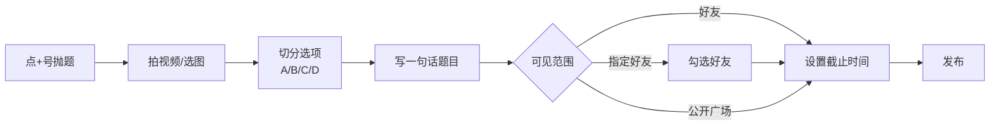
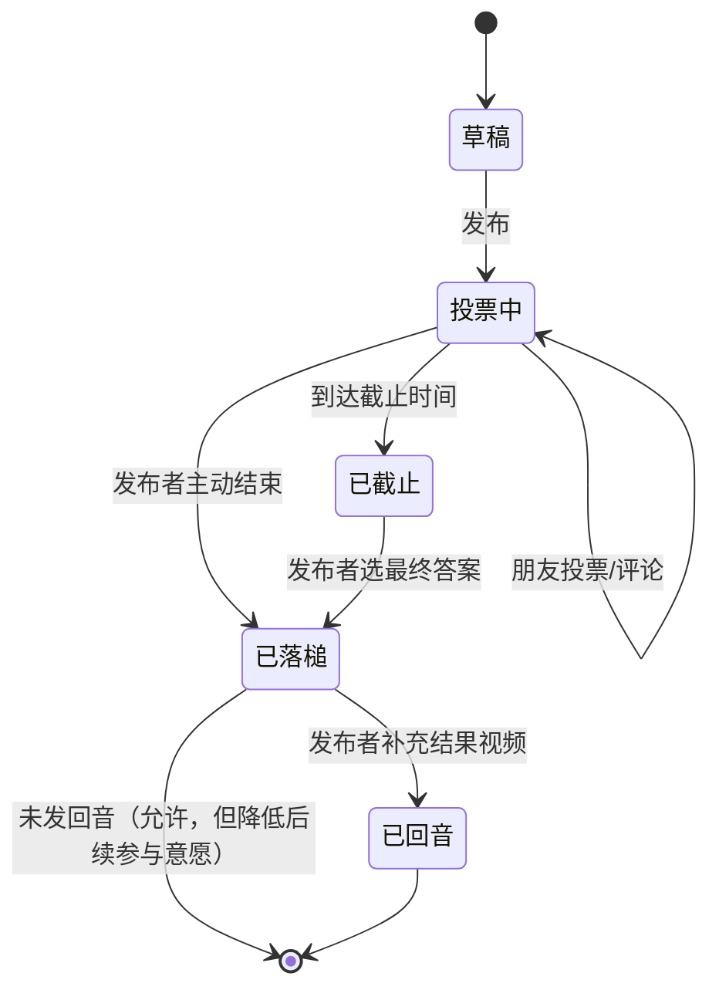
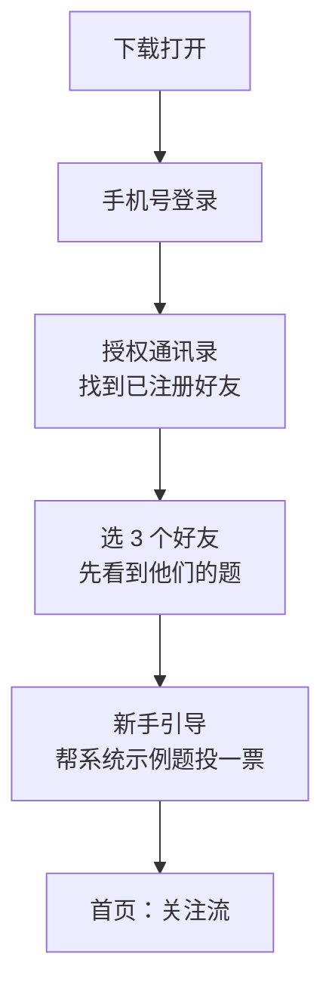
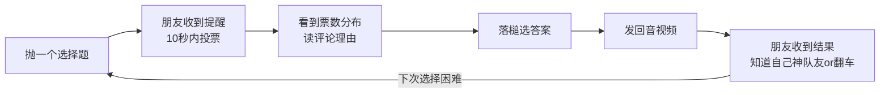

# echoice 产品设计文档

> 面向选择困难症群体的轻社交 App
> 版本：v0.2（概念稿 / MVP 对齐用）
> 更新日期：2026-11-01

---

## 一、产品定位

### 1.1 一句话定位

**把"我选不出来"抛给朋友，让选择变成一次轻松的朋友互动。**

| 项 | 内容 |
|---|---|
| 产品名 | echoice（中文暂用"选回声"） |
| Slogan | 选不出来？抛给朋友。 |
| 产品形态 | 手机 App（iOS / Android），竖屏短视频式交互 |
| 目标用户 | 18–30 岁、日常高频面临小决策、有选择困难倾向、微信好友 200+ 的年轻用户 |
| 核心场景 | 吃什么、穿什么、买哪个、周末去哪、头像换哪个、文案用哪句 |
| 不做什么 | 不做严肃决策工具（不做决策树/加权评分）、不做陌生人交友、不做种草电商 |

### 1.2 为什么是"轻社交"而不是"工具"

选择困难的人真正卡住的不是"分析能力"，而是三件事：

1. **不好意思问**——吃什么都要问人，显得没主见；
2. **问了没人认真答**——大群里抛个问题被淹没，私聊又怕打扰；
3. **问完就结束了**——选了之后也没人关心结果，没有闭环。

所以产品的切入点不是"帮你算清楚"，而是**把选择困难这件事游戏化、内容化、社交化**，让"抛选择题"本身成为朋友之间一种轻松的互动方式，类似"转个锦鲤""发个测试题"那样的社交货币。

### 1.3 与竞品的关键差异

| 产品 | 它解决什么 | echoice 的差异 |
|---|---|---|
| 小红书 / 大众点评 | 推荐你"该买什么、该吃什么" | echoice 不替你决定，只让朋友替你选 |
| 微信群投票 / 问卷星 | 正式、有目的的投票 | echoice 是随手拍、低压力、10 秒完成的轻互动 |
| 即刻 / Soul | 陌生人社交、兴趣社交 | echoice 只围绕"选择"这一个动作做社交，关系链优先好友 |
| 决策类工具 App | 理性分析、加权打分 | echoice 走感性、游戏化路线，不做复杂计算 |

---

## 二、目标用户与典型场景

### 2.1 用户画像

| 画像 | 特征 | 典型选择难题 |
|---|---|---|
| **纠结型大学生** | 18–22 岁，生活费有限，怕踩雷 | "这双鞋两双哪个好看？""周末去 A 馆展还是 B 馆展？" |
| **精致白领** | 23–28 岁，重视性价比和颜值，社交圈广 | "这两个 offer 接哪个？""相亲穿哪件？" |
| **选择困难重症者** | 任何决策都要问人，习惯发好友群 | "今天外卖吃什么？""这个头像换哪个？" |
| **热心帮选者** | 喜欢给朋友出主意、享受"我猜对了"的成就感 | 不怎么抛题，但每天帮朋友选 3–5 次 |

> 产品需要同时服务两类人：**抛题者**（有选择困难的人）和**帮选者**（热心朋友）。只服务抛题者会变成工具；让帮选者也有乐趣和成就感，才能形成社交循环。

### 2.2 典型使用场景

- **场景 A（高频轻决策）**：晚上 7 点，小林站在衣柜前拍了两件卫衣，发 echoice："明天穿哪件？" 10 分钟内 8 个朋友投票+评论，她选了得票高的那件，第二天拍张上身照作为"回音"。
- **场景 B（中决策需要理由）**：小周看中两个手机壳，拍短视频展示细节，选项 A/B，朋友不仅投票还会评论"A 耐脏""B 拍照好看"，他根据评论区的理由做决定。
- **场景 C（重决策求助，P1 版本）**：小吴收到两个 offer，录了一段 60 秒视频讲清楚背景，发给指定的 5 个朋友深度帮选，朋友可以语音回复，形成小范围决策咨询。

---

## 三、产品信息架构

```
echoice
├── 首页（选场）
│   ├── 关注流（好友抛的题）
│   └── 热门广场（全站有趣的选择题）
├── 抛题（发布选择题）
│   ├── 拍视频 / 上传图片
│   ├── 设置选项（2–4 个）
│   └── 设置可见范围（好友 / 指定人 / 公开）
├── 消息
│   ├── 帮选通知（你的朋友等你选）
│   ├── 回音通知（你选的题出结果了）
│   └── 新好友 / 互动
└── 我的
    ├── 我抛的题（带结果闭环）
    ├── 我帮过的题（我的选择战绩）
    ├── 选择人格（基于选择行为的标签）
    └── 好友与关注
```

---

## 四、核心功能设计

### 4.1 抛题（发布一个选择难题）

这是产品的起点。核心要求是**10 秒内完成发布**，不能比发朋友圈更麻烦。

| 要素 | 设计 |
|---|---|
| 内容形式 | 竖屏短视频（≤15 秒）为主，支持纯图片（最多 4 张） |
| 选项数量 | 最少 2 个，最多 4 个；每个选项配一段视频或一张图 |
| 题目描述 | 一句话文字（≤30 字），可选；例如"明天穿哪件？" |
| 可见范围 | ① 全部好友 ② 指定好友 ③ 公开广场（默认仅好友） |
| 投票是否匿名 | 默认匿名投票（朋友不知道你选了啥），但评论和代选实名 |
| 截止时间 | 可选：1 小时 / 6 小时 / 24 小时 / 不截止 |
| 特殊模式 | ① **盲选模式**：帮选者看不到题目描述，只看选项画面，纯直觉选；② **代选模式**：邀请朋友直接"替我做决定" |

**抛题流程图：**



### 4.2 帮选（朋友参与）

帮选者进入一个题目时的界面，就是一个竖屏全屏短视频，和抖音观感一致，但画面下方是选项按钮。

| 帮选方式 | 交互 | 说明 |
|---|---|---|
| **投票** | 点选 A/B/C/D 一个按钮 | 一键完成，匿名；投票后实时看到当前票数分布 |
| **评论建议** | 底部输入框，可发文字 / 语音（≤15 秒） / 表情 | 实名，理由更充分 |
| **代选** | 点"我替他定了"按钮 | 直接帮发布者拍板，发布者会收到强提醒 |
| **转发** | 把题目转给其他朋友 | 扩大帮选范围 |

**帮选者的激励设计（关键）：**
- 投票后立刻看到"你和 X 个朋友选了一样的"——寻找同类；
- 题目出结果后，如果你的选择和发布者最终选的一致，你获得"**神队友**"标签；
- 累计神队友次数，形成"帮选战绩"，满足热心朋友的成就感；
- 评论被发布者采纳（说"听你的"），获得"**军师**"徽章。

### 4.3 回音（结果闭环）

这是 echoice 和所有"投票工具"最本质的区别——**题目必须有结局**。

| 环节 | 设计 |
|---|---|
| 出结果 | 截止时间到，或发布者主动点"落槌"结束投票 |
| 落槌 | 发布者从选项中选一个最终答案（即使和票数不同也可以） |
| 发回音 | 发布者可发一段短视频或图片，展示"我最后选了什么、结果怎样"；例如选了衣服后拍一张上身照 |
| 通知 | 所有帮选过的朋友收到"回音"推送，知道自己选对没 |
| 晒结果 | 回音自动生成一张卡片："小明天穿了 A，8 位朋友选对，2 位翻车"，可分享到微信 |

**一个选择题的完整生命周期状态机：**



### 4.4 轻社交体系

社交不围绕"人"展开，而围绕"选择行为"展开。

| 功能 | 说明 |
|---|---|
| **选择人格** | 基于你帮选/抛题的历史，生成人格标签：如"颜值派""性价比党""冒险王""稳妥派""纠结之王"；可分享成卡片 |
| **选友匹配** | 看看你的好友中，谁和你选择最一致（"你们连吃什么都想到一块"）；谁和你最不一样（"你们是反向风向标"） |
| **热门广场** | 公开的有趣选择题，可围观、可投票；内容调性偏轻松、有趣、生活化，不做严肃讨论 |
| **每日一题** | 官方发起的轻选择题（"今天喝奶茶还是咖啡"），引导沉默用户参与 |
| **好友圈** | 不是 feed 流，而是"你最近 24 小时需要帮朋友选几次"的待办列表，降低参与门槛 |

---

## 五、关键用户流程

### 5.1 首次启动流程



### 5.2 核心循环（Aha Moment）



> **北极星指标**：每周完成"抛题→回音"完整闭环的用户数。只投票不闭环，产品会退化成投票工具；只有闭环跑起来，社交网络才会沉淀。

---

## 六、MVP 范围与优先级

### 6.1 P0（MVP，首版必做）

| 模块 | 功能 | 说明 |
|---|---|---|
| 账号 | 手机号登录、基础资料、通讯录匹配 | 关系链是冷启动核心 |
| 抛题 | 拍视频/选图、2–4 选项、一句话描述、好友可见、24h 截止 | 不做公开广场 |
| 帮选 | 投票（匿名）、文字评论 | 不做语音、不做代选、不做盲选 |
| 闭环 | 落槌、发回音（图片即可）、结果推送 | 闭环必须有 |
| 社交 | 关注好友、看好友的题 | 不做选择人格、不做选友匹配 |
| 消息 | 帮选提醒、回音提醒 | 推送是留存关键 |

### 6.2 P1（上线后 1–2 个版本）

- 公开广场（热门选择题）
- 盲选模式、代选模式
- 语音评论
- 选择人格标签、帮选战绩
- 分享到微信卡片
- **重决策深度咨询**（小范围好友语音讨论，依赖"指定好友 + 语音评论 + 代选"能力组合；已确认纳入 P1，2026-11-01）

### 6.3 P2（探索期）

- 品牌合作（品牌商品作为选项植入）
- 付费代选（选择达人接单）
- 年度选择报告

### 6.4 明确不做（V1 阶段）

- ❌ 陌生人匹配 / 附近的人
- ❌ 种草 / 商品链接 / 直接下单
- ❌ 复杂决策工具（加权评分、决策树）
- ❌ 群聊、动态 feed、长文内容

---

## 七、Roadmap

| 阶段 | 时间 | 目标 | 关键动作 |
|---|---|---|---|
| **冷启动** | 第 1–2 月 | 验证核心循环 | 邀请 500–1000 个种子用户（大学生社群），只做 P0，观察"抛题→回音"闭环率 |
| **PMF 验证** | 第 3–4 月 | 找到留存钩子 | 上线 P1，重点关注次周留存、人均每日帮选次数 |
| **增长** | 第 5–8 月 | 扩大用户规模 | 分享卡片裂变、高校推广、每日一题运营 |
| **商业化探索** | 第 9–12 月 | 验证收入模型 | 品牌选项植入测试、付费功能灰度 |

**进入下一阶段的触发条件：**
- 冷启动 → PMF：周闭环率（一周内完成回音的抛题占比）≥ 40%；
- PMF → 增长：次周留存 ≥ 30%，日均帮选次数 ≥ 3；
- 增长 → 商业化：DAU 达到预期规模，且用户对品牌选项无负面反馈。

---

## 八、商业模式（初步）

| 模式 | 说明 | 风险 |
|---|---|---|
| **品牌选项植入** | 餐饮、快消、服饰品牌可以把自家产品作为"选项"出现在用户的选择题里（例如"A 奶茶 vs B 奶茶"），按曝光计费 | 需控制植入比例，避免伤害体验 |
| **付费会员** | 无限抛题次数、更长视频、更多选项、自定义皮肤 | MVP 阶段不做，先验证需求 |
| **付费代选/咨询** | 选择困难者付费找"选择达人"深度帮忙做决定 | 随 P1 重决策深度咨询一起验证用户意愿 |
| **数据洞察** | 选择偏好报告（B 端品牌了解年轻人选择趋势） | 长期价值，非核心收入 |

---

## 九、风险与对策

| 风险 | 说明 | 对策 |
|---|---|---|
| **冷启动难题** | 抛题者发了题没人投票，一次挫败就流失 | ① 产品早期提供"虚拟朋友"影子投票；② 强推送机制；③ 引导用户先邀请 3 个好友再抛题 |
| **回音率低** | 用户落槌后不发回音，闭环断掉 | ① 回音生成卡片自动做，降低成本；② 对回音行为给徽章激励；③ 超过 48h 未回音发提醒 |
| **内容变水** | 广场出现无聊、引战、低质选择题 | 人工+机审，广场调性偏轻松生活，不做严肃争议题 |
| **隐私问题** | 重决策题（offer、关系）暴露隐私 | 指定好友模式默认隐私，公开广场需二次确认；重决策模式单独加密 |
| **变成朋友圈附庸** | 用户觉得不如直接发微信群 | 强化"帮选战绩""选择人格"等微信群给不了的社交资产 |

---

## 十、关键指标（北极星与护栏）

| 指标类型 | 指标 | 目标（冷启动期参考） |
|---|---|---|
| 北极星 | 每周完成"抛题→回音"闭环的用户数 | 种子期达到活跃用户的 30%+ |
| 抛题侧 | 人均每周抛题数 | ≥ 1.5 |
| 帮选侧 | 人均每周帮选次数 | ≥ 3 |
| 闭环率 | 抛题后 24h 内落槌并回音的比例 | ≥ 40% |
| 留存 | 次日留存 / 次周留存 | 目标 40% / 30%（需实际校准） |
| 护栏 | 举报率、负面反馈率 | 控制在低位 |

---

## 十一、待确认问题

1. ~~产品命名~~：已确认——"选回声"（echoice）；（2026-11-01）
2. ~~重决策场景~~：已确认纳入 P1（2026-11-01），采用"指定好友 + 语音评论 + 代选"组合；
3. **是否做公开广场**：P0 先不做，但需要在 P1 早期决策，因为广场是内容供给和新用户留存的关键；
4. **冷启动种子用户来源**：建议从选择困难相关的社群（豆瓣小组、小红书相关话题）招募，需要运营侧确认。

---

*文档结束。原型进度：可交互 H5 原型已交付（见同目录 HTML），覆盖"抛题→帮选→落槌→回音"核心闭环与重决策 P1 示例。*
